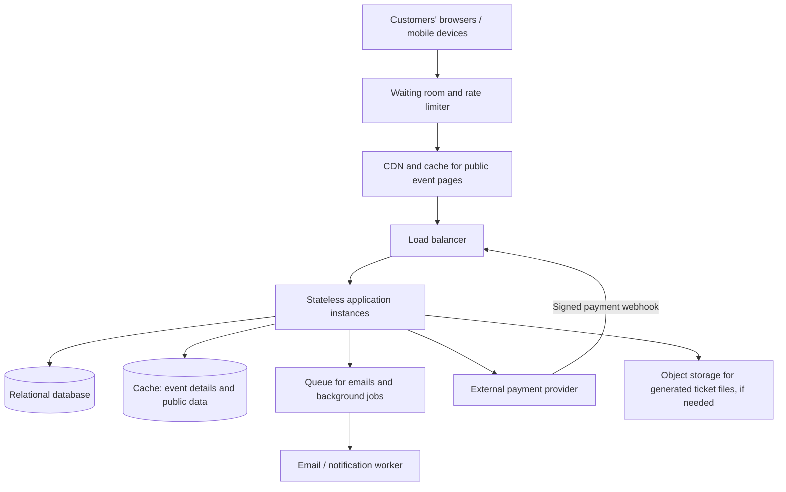

# TicketHub — Ticketing System Design

## 1. Context

TicketHub is a website where people discover concerts and events, choose seats, buy tickets, and view their orders. It must work well on ordinary days and remain reliable when a very popular concert goes on sale.

The system has **2 million registered users**. A normal day has **50,000 visitors**, who view **10 pages each**, and **5,000 tickets are sold**. During a major sale, **200,000 people compete for 20,000 seats in the first 10 minutes**.

The main design challenge is to handle a sudden traffic spike without selling the same seat twice or charging customers for tickets they did not receive.

## 2. Goals and non-goals

### Goals

- Let users browse events and view event details and seat availability.
- Let users temporarily hold available seats while they complete checkout.
- Accept payment and issue tickets after successful payment.
- Let users view their purchased tickets and order status.
- Prevent two customers from purchasing the same seat.
- Keep the service responsive and fair during a popular sale.
- Protect user and payment information.

### Non-goals

- Building a venue's physical access-control hardware.
- Organising the concerts or managing performers.
- Building a resale marketplace.
- Storing raw credit-card details in TicketHub.
- Supporting every country and currency in the first release.

## 3. Requirements and estimates

### Functional requirements

1. Users can register, sign in, and view their account.
2. Users can browse, search, and view events.
3. Users can view a seat map and the current availability of seats.
4. Users can hold one or more available seats for a limited time, such as 5 minutes.
5. Users can pay for a valid seat hold.
6. A successful payment creates a confirmed order and tickets.
7. Users can view their orders and tickets.
8. Expired holds and failed payments release seats for other customers.
9. The system sends a confirmation after an order is confirmed.
10. The system prevents duplicate payment processing if a client retries a request.

### Non-functional requirements

- **Speed:** Event listings and event details should normally load in under 2 seconds at the 95th percentile. Seat availability should normally respond in under 1 second, excluding external payment-provider delays.
- **Correctness:** A seat can have no more than one active hold or confirmed sale for a given event.
- **Fairness:** During a major sale, users should enter through a waiting room or queue. Requests should be admitted in a controlled order rather than allowing one user or automated bot to consume all capacity.
- **Availability:** Aim for 99.9% monthly availability, while prioritising correct booking records over accepting unsafe bookings.
- **Security:** Use HTTPS, authenticated accounts, access controls, input validation, rate limits, and a trusted payment provider. Never store raw card numbers or security codes.
- **Recoverability:** Back up the database and keep payment/order records auditable.
- **Scalability:** Add application instances and queue capacity as demand increases.

### Traffic estimates

#### Normal day

- Page views per day = 50,000 visitors × 10 pages = **500,000 page views/day**.
- Average page views per second = 500,000 ÷ 86,400 ≈ **5.8 page views/second**.
- Tickets sold per day = **5,000**.
- For planning, assume busy periods are 10 times the daily average: about **58 page views/second** at a busy time. This is a planning assumption, not a measured fact.

#### Popular concert sale

- People attempting to buy = **200,000 in 10 minutes**.
- Average arrival rate = 200,000 ÷ 600 seconds ≈ **333 purchase attempts/second**.
- Seats available = **20,000**.
- Demand-to-seat ratio = 200,000 ÷ 20,000 = **10 people per seat**.
- Only 10% of interested buyers can receive a seat if all 20,000 seats are sold to this group.

A purchase attempt may make several API requests—for example, checking availability, creating a hold, and starting payment. If each attempt averages 3 API requests, the sale could generate about **1,000 API requests/second** just for this flow. Real traffic will arrive unevenly, so the system should be load-tested above this average.

| Measure | Normal day | Popular sale |
|---|---:|---:|
| Visitors / purchase demand | 50,000 visitors/day | 200,000 people in 10 minutes |
| Page views | 500,000/day | Not specified; likely concentrated |
| Average relevant rate | 5.8 page views/second | 333 purchase attempts/second |
| Ticket supply | 5,000 tickets sold/day | 20,000 seats |
| Main risk | Ordinary application load | Sudden overload and seat contention |

## 4. Proposed design

### 4.1 API design

Use a REST-style JSON API under `/api/v1`. Require authentication for holds, purchases, and personal orders. Examples below omit authentication headers for readability.

| Method and endpoint | Purpose | Success response | Important errors |
|---|---|---|---|
| `GET /api/v1/events` | Browse/search upcoming events | `200 OK` with event list | `400 Bad Request` for invalid filters |
| `GET /api/v1/events/{eventId}` | View event details | `200 OK` with event details | `404 Not Found` |
| `GET /api/v1/events/{eventId}/seats` | View seats and their availability | `200 OK` with seat list/status | `404 Not Found` |
| `POST /api/v1/holds` | Temporarily hold available seats | `201 Created` with hold ID and expiry | `409 Conflict` if a seat is no longer available; `401 Unauthorized` if not signed in |
| `DELETE /api/v1/holds/{holdId}` | Cancel a hold and release its seats | `204 No Content` | `404 Not Found`; `403 Forbidden` if another user owns it |
| `POST /api/v1/orders` | Create an order from a valid hold and initiate payment | `201 Created` with order ID and payment status | `409 Conflict` for expired/invalid hold; `422 Unprocessable Content` for invalid data |
| `POST /api/v1/payments/webhook` | Receive verified payment-provider updates | `200 OK` after safely recording the event | `400 Bad Request` for invalid signature |
| `GET /api/v1/me/orders` | List the signed-in user's orders | `200 OK` with orders | `401 Unauthorized` |
| `GET /api/v1/me/tickets` | View tickets owned by the signed-in user | `200 OK` with tickets | `401 Unauthorized` |

#### Example: hold seats

Request:

```http
POST /api/v1/holds
Content-Type: application/json
Authorization: Bearer <access-token>
Idempotency-Key: 8d3f...unique-client-key

{
  "eventId": "evt_123",
  "seatIds": ["seat_A12", "seat_A13"]
}
```

Successful response (`201 Created`):

```json
{
  "holdId": "hold_456",
  "eventId": "evt_123",
  "seatIds": ["seat_A12", "seat_A13"],
  "status": "ACTIVE",
  "expiresAt": "2026-10-17T12:05:00Z"
}
```

If another customer already holds either requested seat, return `409 Conflict` and do not create a partial hold. The client should refresh seat availability and ask the user to choose again.

#### Example: create an order

Request:

```http
POST /api/v1/orders
Content-Type: application/json
Authorization: Bearer <access-token>
Idempotency-Key: order-attempt-unique-key

{
  "holdId": "hold_456",
  "paymentMethod": "CARD"
}
```

The response can be `201 Created` with `status: "PENDING_PAYMENT"` and a payment-provider checkout URL or payment intent reference. The final order becomes `CONFIRMED` only after the provider's signed confirmation has been verified and recorded.

**Status-code principles:** `200` means a request succeeded; `201` means a resource was created; `204` means success with no response body; `400` means malformed input; `401` means unauthenticated; `403` means not allowed; `404` means not found; `409` means a state conflict such as a seat already held; and `429` means the client has sent too many requests.

### 4.2 Data model

Use a relational database such as PostgreSQL because users, events, seat assignments, holds, and orders have clear relationships and need transactions and constraints.

#### Tables

**users**
- `id` — primary key
- `email` — required and unique
- `password_hash` — required; never store a plain-text password
- `created_at` — timestamp

**events**
- `id` — primary key
- `title` — required
- `venue_name` — required
- `starts_at` — timestamp
- `sales_open_at` — timestamp
- `status` — for example, `DRAFT`, `ON_SALE`, `SOLD_OUT`, `CANCELLED`

**seats**
- `id` — primary key
- `venue_seat_code` — seat label such as `A12`
- `section` — section/area name
- `row_label` — row identifier
- `seat_number` — seat number

**event_seats**
- `id` — primary key
- `event_id` — foreign key to `events.id`
- `seat_id` — foreign key to `seats.id`
- `price` — fixed price for this event's seat
- `status` — `AVAILABLE`, `HELD`, or `SOLD`
- `hold_expires_at` — nullable timestamp
- `hold_user_id` — nullable foreign key to `users.id`
- `version` — optional integer for optimistic concurrency

Add a **unique constraint on (`event_id`, `seat_id`)** so the same physical seat cannot be added twice for the same event. The price is stored here because the same seat may cost different amounts for different events.

**orders**
- `id` — primary key
- `user_id` — foreign key to `users.id`
- `status` — `PENDING_PAYMENT`, `CONFIRMED`, `FAILED`, `CANCELLED`, or `REFUNDED`
- `total_amount` — required amount in the chosen currency's minor units (for example, cents)
- `currency` — currency code
- `idempotency_key` — unique key for safe retries
- `created_at` — timestamp

**order_items**
- `id` — primary key
- `order_id` — foreign key to `orders.id`
- `event_seat_id` — foreign key to `event_seats.id`
- `unit_price` — price captured when the order was created

Add a unique constraint on `order_items.event_seat_id` for confirmed allocations, or enforce equivalent uniqueness in the booking transaction. If the database design retains cancelled historical order items, use a separate allocation/ticket table or a partial unique index for active allocations so a cancelled order does not permanently block a seat.

**payments**
- `id` — primary key
- `order_id` — foreign key to `orders.id`
- `provider_reference` — unique payment-provider reference
- `status` — `PENDING`, `SUCCEEDED`, or `FAILED`
- `amount` and `currency` — required
- `created_at` — timestamp

**Relationships**

- One user can have many orders.
- One event can have many event-seat records.
- One seat can appear in many events, but only once per event.
- One order has one or more order items.
- Each order item refers to one event-seat allocation.
- An order can have payment attempts recorded against it.

The `event_seats` table represents a seat's availability for a particular event. The `seats` table alone should not store whether a seat is sold, because that same seat can be available for a future event.

### 4.3 How double-booking is prevented

The database—not just the front end—must be the final authority on seat ownership.

1. A user selects seats and requests a hold.
2. The booking service starts a database transaction.
3. It locks the requested `event_seats` rows in a consistent order, or performs a conditional update that succeeds only when each seat is available or its previous hold has expired.
4. It verifies that **all** requested seats can be held. If even one is unavailable, it rolls back the whole transaction.
5. If all seats are available, it marks them `HELD`, sets `hold_user_id` and `hold_expires_at`, creates the hold/order records, and commits.
6. The payment is processed through a payment provider. The hold has a short expiry, such as five minutes.
7. After verified successful payment, a transaction confirms the order and changes the held seats to `SOLD`, but only if the hold still belongs to that user/order and is valid.
8. If payment fails or the hold expires, the seats are released. A late payment callback must be reconciled safely; it must never overwrite another buyer's valid allocation.

Use row locks or atomic conditional updates, transactions, foreign keys, and unique constraints. A simple “check availability, then update later” without a transaction is unsafe: two requests could both see `AVAILABLE` before either updates the row.

Payment webhooks can be delivered more than once. Store each provider event ID uniquely, verify its signature, and make processing idempotent. If payment succeeds after a hold has expired and the seat has been allocated to someone else, do not take that seat away from the new buyer; trigger a refund or manual reconciliation.

### 4.4 High-level architecture



#### What each component does and why it exists

- **Browser/mobile client:** Displays events, seat maps, checkout, orders, and tickets.
- **Waiting room and rate limiter:** Controls how many users enter the sale and limits abusive or excessive requests. It reduces overload but must not promise a seat before the database confirms the hold.
- **CDN and cache:** Serves public event images and cacheable event information close to users. It reduces repeated reads against the application. Seat availability and checkout decisions must always be verified against the authoritative database.
- **Load balancer:** Distributes requests across application instances and stops sending traffic to unhealthy instances.
- **Stateless application instances:** Validate requests and implement business rules. Any instance can handle any request because session state is not kept only in that instance; shared state lives in the database or another shared service. This allows horizontal scaling.
- **Relational database:** Stores users, events, seat allocation, holds, orders, and payments. Transactions and constraints protect booking correctness. Use backups and a tested recovery plan.
- **Cache:** Speeds up public event data. It is not the source of truth for whether a seat can be sold.
- **Queue and notification worker:** Processes emails and other slow tasks asynchronously so checkout does not wait for email delivery.
- **Payment provider:** Handles sensitive payment details. TicketHub stores provider references and verified payment outcomes, not raw card details.
- **Object storage:** Stores generated ticket PDFs or images if needed, without placing large files in database rows.

#### How it survives the big sale

1. A virtual waiting room admits users at a controlled rate and gives them a fair queue position.
2. CDN caching serves event pages and static assets without sending every read to the application.
3. The load balancer distributes admitted requests across multiple stateless application instances.
4. Rate limits and per-user limits reduce bots and accidental request storms.
5. The booking database serializes competing attempts for the same seat using transactions and constraints.
6. The application queues non-essential work such as emails.
7. Monitoring and load tests check latency, error rates, queue length, database lock waits, and payment failures. Capacity can be increased before the sale.

A waiting room cannot create more seats: with 200,000 people competing for 20,000 seats, many customers must be told that tickets are sold out. Fairness means orderly, transparent access—not guaranteeing a ticket to everyone.

### 4.5 Bottlenecks and monitoring

**Likely bottlenecks**
- Database contention when many buyers request the same popular seats.
- Database connection limits and slow queries.
- Payment-provider latency or outages.
- Sudden bursts that exceed application capacity.
- Bots or clients repeatedly refreshing seat availability.

**What to monitor**
- API request rate, latency (especially p95/p99), and error rate.
- Waiting-room size and time spent waiting.
- Database CPU, connections, slow queries, lock waits, and transaction rollbacks.
- Seat-hold success/conflict rates and expired holds.
- Payment success/failure rates and webhook processing delay.
- Queue depth, worker failures, and email delay.
- Availability, backup success, and recovery-test results.

## 5. Alternatives considered and trade-offs

### Trade-off 1: Relational database vs. document database

**Choice:** Use a relational database for orders and seat allocation.

**Why:** Seat ownership depends on strong relationships, unique constraints, and transactions. A document database can scale well for some workloads, but enforcing these booking rules across related records may be more complicated.

**Cost:** Relational transactions and row locks can become a bottleneck during a highly contested sale. We address this with short transactions, indexes, admission control, and load testing.

### Trade-off 2: Cache reads vs. always querying the database

**Choice:** Cache public event details and static assets, but check authoritative seat state in the database when creating a hold or confirming a purchase.

**Why:** Caching reduces repeated reads and improves page speed.

**Cost:** Cached information may be stale, so a displayed seat can become unavailable before checkout. The API must return a clear conflict and let the user refresh.

### Trade-off 3: Immediate processing vs. a waiting room and queue

**Choice:** Use a waiting room during high-demand sales and queue non-essential work.

**Why:** Controlled admission protects the service and gives users a more orderly experience.

**Cost:** Some users must wait, and queue implementation adds complexity. It cannot remove the supply shortage when demand exceeds the number of seats.

### Trade-off 4: Short seat holds vs. no holds

**Choice:** Hold seats for a limited time during checkout.

**Why:** Customers need time to pay without another customer taking the seat.

**Cost:** Abandoned checkouts temporarily make seats unavailable. Expiry processing and careful handling of late payment notifications are required.

## 6. Risks and open questions

- **Payment succeeds but confirmation is delayed:** use idempotent webhooks, reconciliation jobs, and clear pending status.
- **A hold expires while payment is in progress:** define a precise expiry policy and reconcile late payments without double-selling.
- **Database outage:** maintain backups, test recovery, and fail safely rather than confirming unverified bookings.
- **Bot activity:** use rate limits, bot detection, account/device controls, and a transparent waiting-room policy.
- **Fairness policy:** decide whether queue order is first-come-first-served, randomised within a pre-announced window, or another published method.
- **Pricing and refunds:** confirm supported currencies, refund rules, event cancellation handling, and applicable tax requirements.
- **Capacity:** run load tests before a major sale; the estimates in this document are planning assumptions and must be validated with real measurements.

## Conclusion

TicketHub should scale by serving public content through a CDN/cache, admitting high-demand traffic through a waiting room, adding stateless application instances, and moving slow tasks to a queue. Most importantly, seat allocation must be protected by database transactions and constraints. The system should prefer a clear “seat no longer available” response over risking a double sale.
